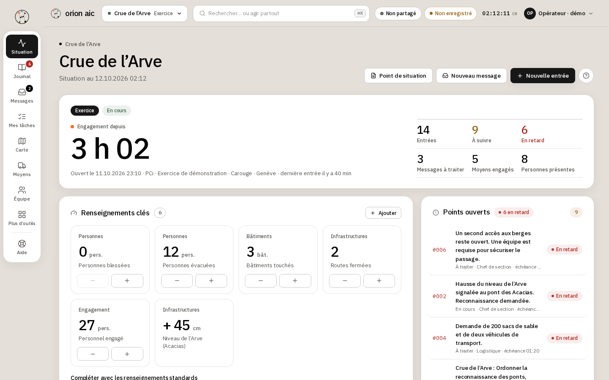

# orion aic

[](https://github.com/ludovic111/orion-aic/actions/workflows/ci.yml)
[](LICENSE)

**L’aide à la conduite pour la protection civile, dans une seule application web.** Journal d’intervention, messages, carte de situation, moyens, équipe et réseau radio Polycom, reliés entre eux. Locale et chiffrée, sans compte ni base de données, synchronisée en direct entre les postes d’un même poste de conduite, utilisable hors ligne.

**Statut :** version 2.1, en service sur <https://orionaic.xyz> depuis le 27 septembre 2026. Logiciel indépendant, non homologué (voir [État du projet et limites](#état-du-projet-et-limites)).



## In English

orion aic is a command-support web app for Swiss civil-protection teams (_Führungsunterstützung_ / _aide à la conduite_): an incident journal, incoming messages, a situation map with Swiss civil symbols on swisstopo maps, resources, team and Polycom radio plan, all linked to one another. It runs in the browser, encrypts everything locally (AES-256-GCM), needs no account and no database, and syncs workstations end-to-end encrypted through a relay that stores nothing. It also works offline and on a local network without internet. The interface is in French, German and Italian; this documentation is in French because its users are French-speaking. Version 2.1 has been live at <https://orionaic.xyz> since 27 September 2026. Built with React, TypeScript and Vite on a small Node.js server; licensed AGPL-3.0-only. It is independent software, not endorsed by the Swiss Federal Office for Civil Protection or any canton.

## Ce que fait orion aic

- **Journal d’intervention** : registre chronologique numéroté, modèles de messages, suivi et échéances, versions, photos, fiches A4, rapport de situation et relève.
- **Messages** : réception standardisée, tri, synthèse, puis inscription au journal en un clic.
- **Carte de situation** : fonds swisstopo et OpenStreetMap, 268 signes civils OFPP, périmètres, coordonnées MN95, couches geo.admin.ch, impression à l’échelle, secteurs hors ligne.
- **Moyens, équipe, missions et ordres** : états des moyens, demandes, organigramme, présences, ordres en cinq points avec accusés de lecture.
- **Réseau radio Polycom** : groupes, noms d’appel, terminaux, remises et retours avec quittance, contrôles de liaison, étiquettes QR.
- **Conduite** : listes de contrôle par type d’événement, rythme de conduite, météo MétéoSuisse et alertes officielles OFEV, seuils.
- **Tout est relié** : chaque élément peut être lié à n’importe quel autre ; un survol montre ce qui s’y rattache.
- **Traçabilité et exports** : qui a fait quoi et quand, retour à n’importe quel moment, présentation de la situation, exports PDF, Word, Excel, PowerPoint, GeoJSON, KML, archive chiffrée, avec signature des documents.
- **Exercices** : scénario d’injects, direction d’exercice et débriefing ; un exercice de démonstration fictif (« Crue de l’Arve ») est fourni.
- **Trois langues** : français, allemand et italien, une langue par poste dans la même session.

## Principe

| Aspect           | Fonctionnement                                                                                                     |
| ---------------- | ------------------------------------------------------------------------------------------------------------------ |
| Données          | Dans le navigateur de chaque poste, chiffrées. Elles ne quittent le poste que par un export ou la synchronisation. |
| Serveur          | Sert les fichiers et relaie des messages chiffrés entre postes. Aucune base de données, rien n’est stocké.         |
| Identité         | L’opérateur déclare son nom ou sa fonction. Aucun compte, aucune authentification.                                 |
| Plusieurs postes | Un **code de session** relie les postes : tout se synchronise en direct, chiffré de bout en bout.                  |
| Hors ligne       | Après un premier chargement, l’application, les signes et les tuiles de carte déjà vues restent disponibles.       |

## Démarrer

### En ligne

1. Ouvrir <https://orionaic.xyz>.
2. **Ouvrir l’exercice de démonstration** pour découvrir un scénario fictif complet, sans toucher aux données locales.
3. Pour un vrai engagement : **Nouvelle session** sur le premier poste, puis **Créer un code de session** et **Rejoindre une session** sur les autres postes.

Pas à pas : [Démarrage rapide](docs/GUIDE.md#démarrage-rapide) dans le guide, ou le module **Aide** de l’application.

### Installer son propre serveur

Prérequis : Node.js 24 (minimum 22.18).

```sh
npm ci
npm run build
npm start          # http://127.0.0.1:4311, à servir en HTTPS en dehors de localhost
```

- **Réseau local sans internet** : `npm run lan` sert l’application en HTTPS sur le réseau du poste de conduite. Pour un serveur autonome dans une valise (Raspberry Pi et son propre Wi-Fi) : [PC en valise](docs/PC-EN-VALISE.md).
- **Docker** : `docker build -t orion-aic .` puis `docker run -p 4311:4311 orion-aic`.
- Hébergement, en-têtes et relais : [Installation et hébergement](docs/GUIDE.md#installation-et-hébergement).

### Développer

```sh
npm run dev           # serveur Vite sur http://127.0.0.1:4311
npm run check         # TypeScript
npm test              # tests Node (node:test)
npm run e2e           # tests de bout en bout (Playwright, Chromium)
```

Détails : [Développement](docs/GUIDE.md#développement) et [Structure du code](docs/GUIDE.md#structure-du-code).

## Documentation

| Document                                                 | Contenu                                                                                            |
| -------------------------------------------------------- | -------------------------------------------------------------------------------------------------- |
| [Guide d’utilisation et d’administration](docs/GUIDE.md) | Chaque module, travail à plusieurs postes, exports, sécurité, limites, installation, développement |
| [PC en valise](docs/PC-EN-VALISE.md)                     | Serveur autonome sans internet : matériel, point d’accès Wi-Fi, démarrage automatique              |
| [Sécurité et confidentialité](SECURITY.md)               | Flux réseau, chiffrement, synchronisation, modèle de menace et limites                             |
| [Architecture](docs/ARCHITECTURE.md)                     | Modèle de données, synchronisation et fusion entre postes                                          |
| [Kit d’interface](docs/UI.md)                            | Écrire un module, traductions                                                                      |
| [Système de design](docs/DESIGN.md)                      | Typographie, couleurs, thèmes                                                                      |
| [Choix métier et sources](docs/JOURNAL.md)               | Références OFPP et CSSP, correspondance avec le produit                                            |
| [Composants tiers](THIRD_PARTY_NOTICES.md)               | Bibliothèques, polices, signes et fonds de carte                                                   |

Dans l’application, le module **Aide** documente chaque écran en trois niveaux de détail et en trois langues.

## État du projet et limites

La version 2.1 est en service sur <https://orionaic.xyz> depuis le 27 septembre 2026. La CI (format, TypeScript, tests, build, tests de bout en bout dans Chromium, `npm audit`, image Docker) s’exécute à chaque push. Limites connues :

- **Non homologué.** Logiciel indépendant, sans affiliation, homologation ni approbation de l’OFPP, de l’OCPPAM ou de l’État de Genève. L’emploi de données réelles exige un poste, une installation et une autorisation de l’organisation. Le chiffrement ne vaut pas à lui seul conformité à la LIPAD ou à la LPD.
- **Identité déclarative.** Les noms d’opérateur ne sont pas authentifiés ; l’historique n’est pas une signature électronique, et la signature des exports est auto-signée, sans horodatage de confiance.
- **Le code de session est un mot de passe.** Il donne accès à toute la session. Changer le code écarte un poste pour la suite, mais rien ne peut effacer à distance ce qu’il a déjà reçu.
- **Stockage dans le navigateur.** Effacer les données du navigateur efface la sauvegarde locale ; seule une archive exportée la remplace.
- **Plan radio documentaire.** Il ne pilote pas les terminaux ; les numéros réels viennent du plan de flotte cantonal.
- **Pièces jointes** : photos seulement.
- **Un seul relais** : le relais de synchronisation garde les salles en mémoire et tourne sur une seule instance.

Liste complète, avec les limites chiffrées : [Limites](docs/GUIDE.md#limites) et [SECURITY.md](SECURITY.md).

## Retours et contributions

Une idée, un besoin, quelque chose à changer ? Écrire à <ludo47j@gmail.com> (aussi dans l’application : menu opérateur → « Une idée, un besoin ? »), ou ouvrir une issue sur ce dépôt, avec des données fictives uniquement. Un problème de sécurité se signale en privé : voir [Signaler un problème](SECURITY.md#signaler-un-problème).

## Licence

AGPL-3.0-only : voir [LICENSE](LICENSE). Le code source complet de la version en service est téléchargeable depuis l’application (menu opérateur → « Code source · AGPL-3.0 »). Composants tiers et leurs licences : [THIRD_PARTY_NOTICES.md](THIRD_PARTY_NOTICES.md).

© Ludovic Marie
